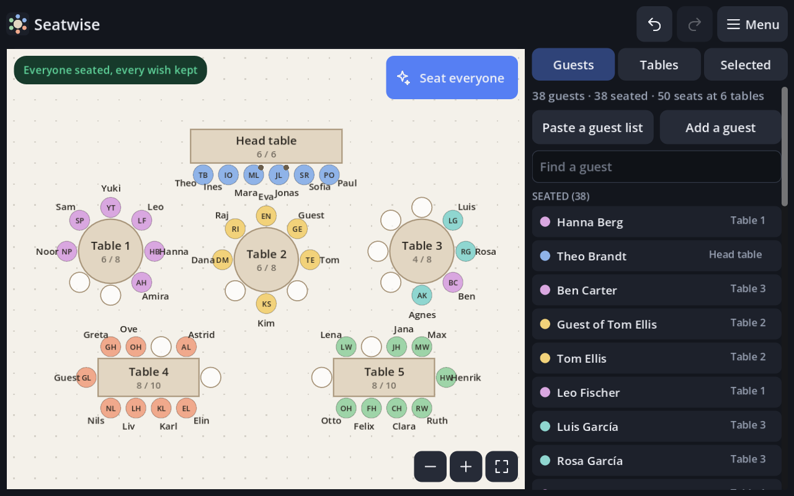

# Seatwise



Seating plans for weddings, dinners, conferences and classes, in the browser. Paste your guest list, say who
should sit together and who should not, and press **Seat everyone**: Seatwise fills the tables for you. Then
drag people around until it feels right, and download the chart.

- **Guests**: paste a list straight from an email or a spreadsheet. One guest per line, with a group and a meal
  after commas (or tabs). `Tom & Lisa Meyer` adds a couple, `Jo Kim +1` adds a guest, and a line like `Family:`
  sets the group for the lines below it. A `.csv` or `.txt` file works too.
- **Tables**: round, long (with end seats from 8 up) and head tables, 1 to 24 seats. Drag them where they stand in
  the room and turn the long ones.
- **Wishes**: households and couples always sit side by side; people you keep apart never share a table; a locked
  seat never moves.
- **Seat everyone**: an optimiser (simulated annealing on seat swaps, then a final pass that tries every swap)
  seats everyone without a seat and improves the whole plan: wishes first, then keeping groups together. You
  watch the tables fill up. Run it again for another good plan.
- **By hand**: drag a guest to an empty seat to move them, or onto someone to swap. Tap a waiting guest in the
  list, then an empty seat. Everything can be undone.
- **Checks in words**: "Ben Carter and Hanna Berg should not sit at Table 2 together", "Pia and Leon Vogt are
  split across 2 tables", "3 guests have no seat: add 3 more seats".
- **Meals**: vegetarian, vegan, gluten-free and kids' meals counted per table and for the whole event.
- **Share it**: download the seating chart (PNG), an alphabetical "find your seat" list for the entrance (PNG),
  and the guest list with tables and seats (CSV). Save the whole plan as a file and open it again.
- **Private**: the plan stays in this browser (IndexedDB). No accounts, no tracking, no network requests.
- Phone and desktop; mouse, touch (two fingers move and zoom) and keyboard.

Made with **Godot 4.7** (GDScript, Compatibility renderer, single-threaded web export, so no special headers).

## Build

The web export is committed in `web/` and served as is (see `strux.json`). To export it again, with Godot 4.7.2
and its web export templates installed:

```sh
GODOT=/path/to/godot ./export.sh
```

`export.sh` imports the project, runs the logic tests (`project/tests/test_seating.gd`, headless: seats, pasted
lists, the optimiser, files and undo) and exports to `web/`.

## Licence

MIT
