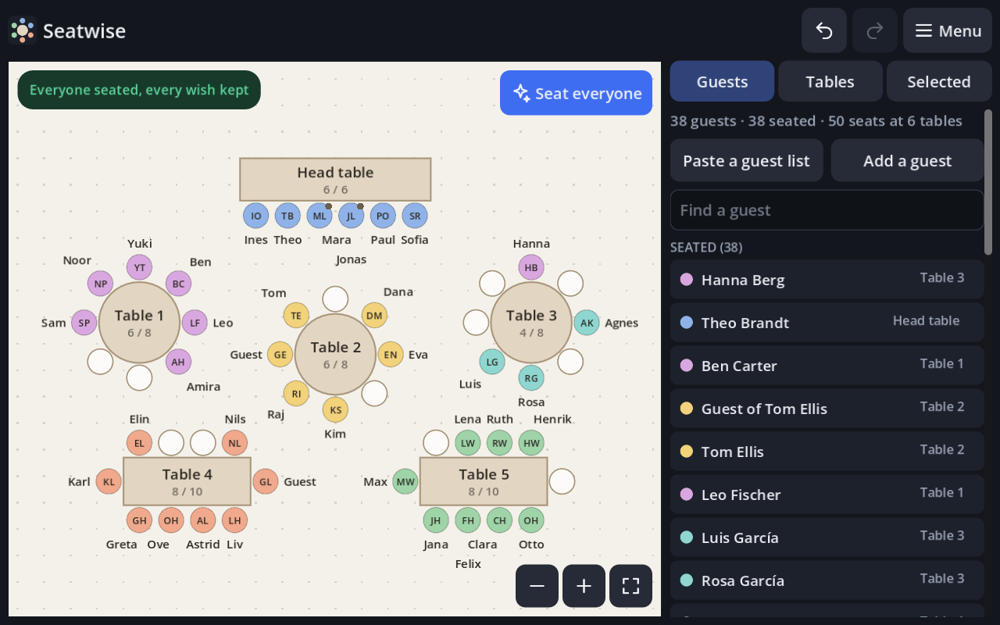

# Seatwise

Seating plans for weddings, dinners, conferences and classes, in the browser. Paste your guest list, say who
should sit together and who should not, and press **Seat everyone**: Seatwise fills the tables for you. Then
drag people around until it feels right, and download the chart.

## Screenshots



## What it does

- **Guests**: paste a list straight from an email or a spreadsheet. One guest per line, with a group and a meal
  after commas (or tabs). Quoted CSV cells work (`"Lee, Ann",Work,vegan`). `Tom & Lisa Meyer` adds a couple,
  `Jo Kim +1` adds a guest, and a line like `Family:` sets the group for the lines below it. A `.csv` or `.txt`
  file works too. A plan holds up to 600 guests.
- **Tables**: round, long (with end seats from 8 up) and head tables, 1 to 24 seats. Drag them where they stand in
  the room and turn the long ones.
- **Wishes**: households and couples always sit side by side; people you keep apart never share a table; a locked
  seat never moves.
- **Seat everyone**: an optimiser (simulated annealing on seat swaps, then a final pass that tries every swap)
  seats everyone without a seat and improves the whole plan: wishes first, then keeping groups together. You
  watch the tables fill up. Run it again for another good plan.
- **By hand**: drag a guest to an empty seat to move them, or onto someone to swap. Tap a waiting guest in the
  list, then an empty seat. Everything can be undone.
- **Checks in words**: "Ben Carter and Hanna Berg should not sit at Table 2 together", "Pia and Leon Vogt are
  split across 2 tables", "3 guests have no seat: add 3 more seats".
- **Meals**: vegetarian, vegan, gluten-free and kids' meals counted per table and for the whole event.
- **Share it**: download the seating chart (PNG), an alphabetical "find your seat" list for the entrance (PNG),
  and the guest list with tables and seats (CSV, with formula-like cells written as text). Save the whole plan
  as a file and open it again.
- **Private**: the plan stays in this browser (IndexedDB). No accounts, no tracking, no network requests.
- Phone and desktop; mouse, touch (drag the floor to move, pinch to zoom) and keyboard (Ctrl+Z, Ctrl+S, + and -).

## Accessibility and limits

Seatwise is a Godot App: the plan and the controls are drawn on one `<canvas>`. Screen readers cannot read
the controls or the plan. The page has a hidden live region that announces a short summary whenever the plan
changes ("42 guests, 40 seated, 2 things to look at"), and the downloaded CSV and seat list carry the whole
plan in text. Keyboard users can reach every button with Tab; the plan itself needs a pointer to drag seats.

## Run it locally

The web export in `web/` is ready to serve as it is (single-threaded, so it needs no special headers):

```sh
python -m http.server 8000 --directory web
```

Then open http://localhost:8000. To work on the project, open `project/` in Godot 4.7.2.

## Run the tests

From the repository root, with Godot 4.7.2:

```sh
godot --headless --path project --import
godot --headless --path project --script res://tests/test_seating.gd
godot --headless --path project --script res://tests/test_app.gd
```

`test_seating.gd` checks the logic: tables and seats, households, problems, pasted lists and CSV quoting, the
example wedding, the solver (the same stepwise solver the App runs), files, undo, and the plan view's hit
testing and name labels. `test_app.gd` runs the whole editor without a window: Seat everyone, the status badge,
toasts, the menu, dialogs, pasting, the guest limit, saving and opening files, and the phone layout. It keeps
its plan in `user://test-app-plan.json`, never in your real one. Each exits with 1 when a check fails.

## Build

`web/` was exported with **Godot 4.7.2** (GDScript, Compatibility renderer, single-threaded web export). To
export it again, with Godot 4.7.2 and its web export templates installed:

```sh
GODOT=/path/to/godot ./export.sh
```

`export.sh` checks the Godot version and the icons, imports the project, runs both test suites and exports to
`web/`, the folder that is served (`strux.json`). Commit the new `web/` with the change that needed it.

## Project layout

- `project/scripts/`: the model (`seating.gd`), the solver (`seating_solver.gd`), pasted lists
  (`guest_import.gd`), files (`plan_file.gd`), the plan view (`venue_view.gd`, with `label_layout.gd` for the
  name labels), and the editor: `main.gd` wires `plan_panel.gd`, `side_panel.gd` (with `guest_page.gd`,
  `table_page.gd`, `inspector.gd`), `main_menu.gd`, `sheets.gd` (dialogs), `picture_export.gd` and `file_io.gd`.
  `ui_theme.gd` and `ui.gd` hold the look and the widget builders.
- `project/icons/`: the line icons of the buttons.
- `project/shell.html`: the page around the canvas, with the loading screen and the browser helpers.
- `icon.svg` is the listing icon. `project/icon.svg` is the same picture for the App itself (its logo and the
  page icon), because Godot only reads files inside `project/`. `export.sh` stops when the two differ.

## Licences

Seatwise is MIT licensed, © 2026 iSquare Lab (see `LICENSE`).

The App runs on the [Godot Engine](https://godotengine.org) (MIT licence), which is compiled into
`web/index.wasm` and `web/index.js` together with third-party code and fonts under their own licences, among
them FreeType, HarfBuzz, ICU and the Open Sans font (OFL 1.1). See `THIRD_PARTY_NOTICES.md`; the App also shows
these licences under Help > Licences.
